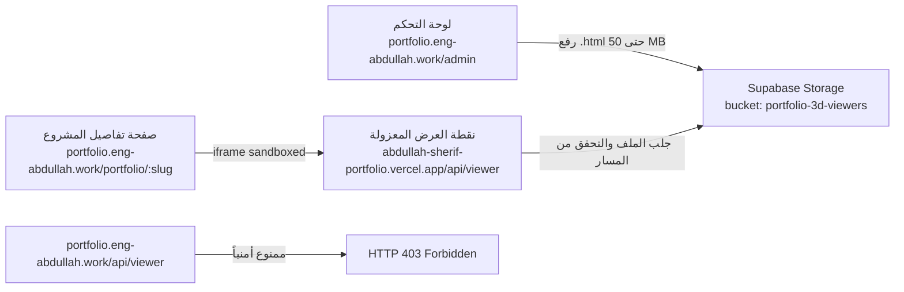

# تقرير دعم رفع ملفات SolidWorks eDrawings HTML المستقلة (Isolated 3D Viewer Architecture & Test Report)

**المشروع:** عبدالله شريف — المنصة والملف الهندسي المهني (`https://portfolio.eng-abdullah.work`)
**التاريخ:** 2026-11-24
**الميزة:** رفع واستضافة ملف `.html` مستقل واحد (SolidWorks eDrawings) لكل مشروع مباشرة من `/admin/pages/portfolio` وعرضه تفاعلياً في صفحة تفاصيل المشروع عبر نطاق معزول بالكامل.

---

## 1. معمارية الاستضافة المعزولة (Isolated Hosting Architecture)

- **التخزين (Supabase Storage):**
  - إنشاء حاوية مخصصة **`portfolio-3d-viewers`** ([`20261124000900_portfolio_3d_viewers_bucket.sql`](file:///e:/Eng%20Abdullah/Antigravity/poject%201/supabase/migrations/20261124000900_portfolio_3d_viewers_bucket.sql)) بحد أقصى **50 ميجابايت** للملف الواحد (`text/html`)، مع سياسات RLS تحصر `INSERT/UPDATE/DELETE` على المسؤول المعتمد فقط عبر `private.is_admin()`.
- **العرض على نطاق معزول (Isolated Origin):**
  - نقطة الخادم [`api/viewer.ts`](file:///e:/Eng%20Abdullah/Antigravity/poject%201/api/viewer.ts) على Vercel (مع استثناء `/api/` في [`vercel.json`](file:///e:/Eng%20Abdullah/Antigravity/poject%201/vercel.json)) تُشغّل ملفات الـ HTML المرفوعة **حصرياً** على النطاق المعزول `https://abdullah-sherif-portfolio.vercel.app/api/viewer?path=...` (المعزول تماماً بموجب Same-Origin Policy عن النطاق الرئيسي `https://portfolio.eng-abdullah.work`).
  - يدعم النظام أيضاً متغير البيئة الاختياري `VITE_VIEWER_ORIGIN` (مثل `https://viewer.eng-abdullah.work`) إذا أردت لاحقاً ربط نطاق فرعي مخصص دون أي تعديل برمجي.

---

## 2. إعدادات الأمان والتوافق (Security & Compatibility)

1. **منع التنفيذ على النطاق الرئيسي (Host Isolation Guard):**
   - أي طلب على `https://portfolio.eng-abdullah.work/api/viewer` يُرفض فوراً بـ **HTTP `403 Forbidden`**.
   - تم التحقق حياً أن النطاق المعزول يحوي `localStorage: []` (`hasSupabaseAuth: false`) و `document.cookie: ""` — أي لا يمكن لأي سكربت داخل ملف HTML مرفوع الوصول إلى جلسة الإدارة أو بيانات النطاق الرئيسي.
2. **منع تخطي المسار و SSRF:**
   - التحقق الصارم بالنمط `/^projects\/[a-z0-9_-]+\/[a-z0-9_-]+\.html$/i` (رفض أي محاولة مثل `../../etc/passwd` بـ **HTTP `400 Bad Request`**).
3. **سياسة أمان المحتوى (CSP) الداعمة لـ SolidWorks eDrawings WebGL:**
   - تسمح بتشغيل JavaScript و WebGL و WASM و `data:` / `blob:` و Web Workers اللازمة لتصديرات eDrawings المستقلة.
   - تمنع الاتصال الخارجي (`connect-src 'self' data: blob:`) وتمنع `<object>` و `<form>` و `<base>`، وتقصر التضمين (`frame-ancestors`) على نطاقات الموقع فقط.
4. **عزل الـ `<iframe>` في [`ProjectDetailPage.tsx`](file:///e:/Eng%20Abdullah/Antigravity/poject%201/src/features/portfolio/ProjectDetailPage.tsx):**
   - `sandbox="allow-scripts allow-same-origin allow-pointer-lock allow-downloads"`
   - `allow="fullscreen; xr-spatial-tracking"` + `referrerPolicy="no-referrer"` + `loading="lazy"`
   - دعم **ملء الشاشة (`Fullscreen`)** و**الفتح في تبويب جديد (`Open in New Tab`)** و**الرسالة البديلة (`Fallback`)**.

---

## 3. ما تم إضافته في لوحة التحكم (`/admin/pages/portfolio` ← تبويب `3D Viewer`)
- وضعان في [`ProjectMediaAndFilesTabs.tsx`](file:///e:/Eng%20Abdullah/Antigravity/poject%201/src/features/admin/projects/ProjectMediaAndFilesTabs.tsx):
  1. **رفع ملف `.html` مستقل (الافتراضي):** رفع ملف واحد لكل مشروع (حتى 50 MB بدون ZIP أو مجلدات مرافقة)، عرض الاسم والحجم والرابط المعزول، **استبدال الملف** (يحذف القديم تلقائياً)، **حذف الملف**، معاينة حية، وفتح في تبويب جديد.
  2. **رابط عارض خارجي (HTTPS):** مُحتفظ به كخيار بديل كامل.

---

## 4. نتائج الاختبار الحي على الإنتاج (`https://portfolio.eng-abdullah.work`)

| الاختبار الفعلي على الإنتاج | النتيجة | التفاصيل |
|---|---|---|
| `GET https://portfolio.eng-abdullah.work/api/viewer?path=...` | **PASS (`403`)** | مرفوض تماماً على النطاق الرئيسي |
| `GET https://abdullah-sherif-portfolio.vercel.app/api/viewer?path=../../etc/passwd` | **PASS (`400`)** | حجب Path Traversal |
| رفع ملف WebGL HTML مستقل (`water-turbine-edrawings-test.html`, 8.1 KB) من `/admin/pages/portfolio` | **PASS** | رُفع إلى `portfolio-3d-viewers` وحُفظ في Supabase |
| عرض المشروع العام `https://portfolio.eng-abdullah.work/portfolio/water-turbine` | **PASS** | ظهر قسم `Interactive 3D CAD Viewer` داخل `iframe` المعزول (`731×540`) مع أزرار `Fullscreen` و `Open in New Tab` وعمل WebGL و JS بنجاح (`WebGL ACTIVE · Interactive 3D Model Loaded`) |
| فتح الرابط المعزول مباشرة والتحقق من التفاعل والعزل | **PASS** | النقر على زر التحكم داخل النموذج غيّر الحالة (`SPINNING` ↔ `PAUSED`)، وتأكد عزل الأصل (`localStorage: []`, `document.cookie: ""`) |
| استبدال الملف (`water-turbine-v2.html`) ← حذف الملف ← إعادة المشروع لحالته النظيفة | **PASS** | تم الاستبدال والحذف وإخفاء قسم العارض من الصفحة العامة نظيفاً |
| أخطاء Console / طلبات الشبكة الفاشلة | **PASS** | `0` أخطاء Console · `0` أخطاء CSP · `0` طلبات شبكة فاشلة (27/27 طلباً `200`/`304`) |

### لقطات الشاشة الموثّقة من الإنتاج
1. **تبويب 3D Viewer بعد رفع ملف `.html` المستقل في لوحة التحكم:** [qa_3d_viewer_admin_upload.png](file:///C:/Users/X%20IT/.gemini/antigravity/brain/43f7ca94-671e-4682-8066-c0c109970609/qa_3d_viewer_admin_upload.png)
2. **عرض نموذج WebGL ثلاثي الأبعاد حياً على صفحة المشروع العامة (`/portfolio/water-turbine`):** [qa_3d_viewer_public_webgl.png](file:///C:/Users/X%20IT/.gemini/antigravity/brain/43f7ca94-671e-4682-8066-c0c109970609/qa_3d_viewer_public_webgl.png)
