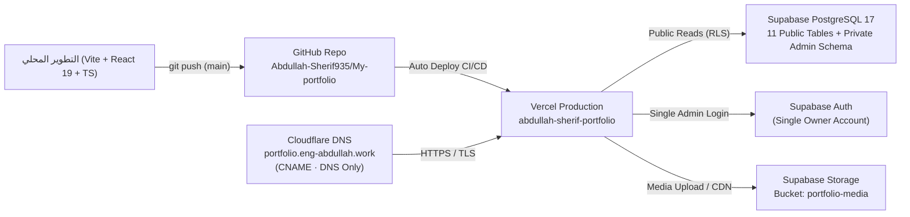

# التقرير الشامل لحالة المشروع والبنية التحتية والربط (Master Project Report)
## منصة الملف الهندسي الشخصي والمهني — م. عبدالله شريف عبدالرؤوف

**تاريخ إعداد التقرير:** 23 نوفمبر 2026  
**حالة المشروع الحالية:** حي ومباشر على الإنترنت (Production Live) — المراحل **01 → 04** مكتملة ومُختبَرة بالكامل  
**النطاق المباشر (Production Domain):** https://portfolio.eng-abdullah.work  
**رابط النشر الأساسي على Vercel:** https://abdullah-sherif-portfolio.vercel.app  
**لوحة التحكم الإدارية:** https://portfolio.eng-abdullah.work/admin/login  
**مستودع الكود (GitHub):** https://github.com/Abdullah-Sherif935/My-portfolio

---

## 1. النظرة المعمارية الشاملة للمنظومة المتكاملة

تعمل المنصة الآن كمنظومة إنتاجية متكاملة تربط التطوير المحلي بالاستضافة السحابية وقاعدة البيانات والتخزين والنطاق المخصص:

---

## 2. المراحل المُنجزة بالتفصيل

### أ. المرحلة 01 — التأسيس البرمجي ودمج بيانات السيرة الذاتية (`Phase 01`)
- تأسيس الواجهة الأمامية بأحدث التقنيات: **React 19 + TypeScript (Strict) + Vite 6 + Tailwind CSS v4 + React Router v7 + Motion for React + Lucide React + i18next**.
- تصميم هوية بصرية هندسية صناعية (**Deep Navy + Orange Engineering Accent**) مع نظام **الوضع الداكن والفاتح (Dark / Light Theme)** وحفظ التفضيل في المتصفح.
- دعم كامل للغتين **العربية والإنجليزية (`AR / EN`)** مع التبديل التلقائي للاتجاه (`RTL / LTR`) والخطوط المخصصة (`IBM Plex Sans Arabic` / `Inter` / `JetBrains Mono`).
- استخراج ودمج البيانات الموثّقة من السيرة الذاتية (`Abdullah_Sherif_Resume.pdf`) بدون اختلاق أي معلومات أو أرقام غير موثّقة.
- قص وتجهيز صورة التخرج الشخصية (`public/images/abdullah-portrait.jpg`) داخل الإطار الهندسي في قسم البداية (`HeroSection`) مع أيقونة الموقع (`public/favicon.svg`).

### ب. المرحلة 02 — تطوير الموقع العام ودراسات الحالة (`Phase 02`)
- إنشاء صفحات الشركات التفصيلية (`/companies/:slug`) وربطها بالمشاريع والخبرات مع عرض واضح لحالات السجلات قيد التوثيق دون ادّعاء علاقات غير مؤكدة.
- تطوير صفحة المشاريع (`/portfolio`) بإضافة:
  - البحث الفوري بالنص والكلمات المفتاحية ومزامنته مع الرابط (`URL Search Params`).
  - التصفية حسب التخصص الهندسي (`category`) ونوع المشروع (`graduation / engineering / industrial`).
- تطوير صفحة تفاصيل المشروع (`/portfolio/:slug`) إلى **دراسة حالة هندسية منظمة** تدعم: التحدي الهندسي، الحل/المنهجية، المساهمات، المواصفات الفنية، النتائج، صورة الغلاف، معرض الصور، المشاريع ذات الصلة، والتنقل السابق/التالي (`Previous / Next`).
- تعريب كامل بنسبة **100%** مع عناوين صفحات ديناميكية (`document.title`) لكل صفحة باللغتين.

### ج. المرحلة 02.1 — تحسين تجربة الهاتف المحمول (`Mobile UX Optimization`)
- تقليل المساحات العمودية وتكرار النصوص في شاشة الجوال (`375px / 390px`) لإظهار الصورة الشخصية والمشاريع الهندسية بشكل أسرع.
- دمج قسم المقدمة وتبسيط بطاقة البروفايل وبطاقة الشركات في الصفحة الرئيسية، وإخفاء الشارات الإدارية الداخلية (`dataSource` / `isEditable`) عن الزوار العامين مع إبقائها داخل لوحة التحكم.

### د. المرحلة 03 — لوحة التحكم الإدارية الكاملة (`Phase 03 Admin CMS UI`)
- بناء لوحة تحكم متكاملة على نفس النطاق (`/admin` و `/admin/login`) بهوية بصرية متناغمة مع الموقع وتخطيط إداري مستقل (Sidebar ثابت على الديسكتوب + Drawer منزلق على الجوال + Breadcrumbs).
- بناء **11 وحدة إدارية متكاملة**:
  1. لوحة النظرة العامة (`Dashboard`) بإحصاءات حية ومؤشر جاهزية المحتوى وسجل الأنشطة.
  2. إدارة الملف الشخصي (`Profile`) مع معاينة مباشرة.
  3. إدارة المشاريع (`Projects`) بنموذج مبوّب من 5 تبويبات (أساسي، تفاصيل هندسية، تقنيات، وسائط، علاقات).
  4. إدارة الشركات (`Companies`) مع ربط المشاريع والخبرات وتحديد نوع العلاقة.
  5. إدارة الخبرات والتدريب الصناعي (`Experience`) مع إعادة الترتيب.
  6. إدارة التعليم الأكاديمي (`Education`).
  7. إدارة مجموعات المهارات (`Skills`) مع إعادة الترتيب وتبديل الظهور/الإخفاء.
  8. إدارة الدورات والشهادات (`Certifications`).
  9. مكتبة الوسائط (`Media Library`).
  10. مدير هيكل السيرة الذاتية (`CV Manager` — تجهيز للمرحلة 05).
  11. إعدادات الموقع والـ SEO وظهور الأقسام (`Settings`).

### هـ. المرحلة 04 — الربط الكامل بـ Supabase (قاعدة البيانات + المصادقة + التخزين)
- تثبيت حزمة `@supabase/supabase-js` وتكوين البيئة المحلية الآمنة `.env.local` (مُتجاهلة تمامًا في `.gitignore`) وتحديث `.env.example`.
- تصميم وتطبيق **5 ملفات SQL Migrations** على مشروع Supabase (`xgrhtukgudnbmtovghlw` — PostgreSQL 17، منطقة `eu-central-1`).
- تفعيل **Row-Level Security (RLS)** على **12/12 جدولًا**، وتفعيل سياسات قراءة عامة للمنشور فقط + كتابة وتعديل وحذف محصورة في حساب المدير الوحيد المعتمد.
- ترحيل جميع السجلات الموثّقة إلى PostgreSQL بدون فقد أو تكرار (`ON CONFLICT DO NOTHING`).
- إنشاء وتأمين **Supabase Storage Bucket** باسم `portfolio-media` وربطه بصفحة `AdminMediaPage` لرفع وحذف الصور وملفات PDF مباشرة.
- تفعيل المصادقة الحقيقية عبر `Supabase Auth` لحساب أدمن واحد فقط (`eng.abdullah.sherif@gmail.com`) مسجّل في جدول `private.admin_users` مع حماية جميع مسارات `/admin/*` عبر `AdminProtectedRoute`.
- ربط **جميع صفحات وأقسام الموقع العام الـ 20** بالبيانات الحية من Supabase عبر `PortfolioDataProvider` مع التحديث الفوري عند أي تعديل إداري.

---

## 3. خريطة المسارات (Routes Inventory)

| المجموعة | المسارات | الحماية / الوصول |
| --- | --- | --- |
| **الموقع العام (Public)** | `/`، `/about`، `/portfolio`، `/portfolio/:slug`، `/companies`، `/companies/:slug`، `/experience`، `/skills`، `/certifications`، `/contact` | مفتوحة للجميع (قراءة منشورة من Supabase عبر RLS) |
| **مصادقة الإدارة** | `/admin/login` | عامة للوصول فقط — تسجيل دخول لمالك واحد فقط (بدون Sign-up) |
| **لوحة التحكم (Admin CMS)** | `/admin`، `/admin/profile`، `/admin/projects`، `/admin/companies`، `/admin/experience`، `/admin/education`، `/admin/skills`، `/admin/certifications`، `/admin/media`، `/admin/cv`، `/admin/settings` | محمية عبر `AdminProtectedRoute` + جلسة Supabase Auth + `private.admin_users` |
| **مسارات مستقبلية محجوزة** | `/career`، `/career/cv-builder`، `/career/jobs`، `/career/applications` | صفحات تحضيرية للمرحلة 05+ |

---

## 4. جرد قاعدة البيانات والتخزين السحابي (Supabase)

- **المشروع:** `Abdullah-Sherif935's Project` (`xgrhtukgudnbmtovghlw` — PostgreSQL 17، `eu-central-1`)
- **عدد ملفات الـ Migrations في `supabase/migrations/`:** `5` ملفات مُطبّقة بالكامل:
  1. `20261123000100_init_schema.sql`
  2. `20261123000200_rls_policies.sql`
  3. `20261123000250_harden_private_admin_users.sql`
  4. `20261123000300_storage_bucket.sql`
  5. `20261123000400_seed_initial_data.sql`

| الجدول / المخزن | الـ Schema | حالة RLS | عدد السجلات الحالية | صلاحية الزائر (`anon`) | صلاحية الأدمن المعتمد |
| --- | --- | --- | :---: | --- | --- |
| `profiles` | `public` | مفعّل ✅ | 1 | قراءة المنشور فقط | CRUD كامل |
| `education` | `public` | مفعّل ✅ | 1 | قراءة المنشور فقط | CRUD كامل |
| `companies` | `public` | مفعّل ✅ | 4 | قراءة المنشور فقط | CRUD كامل |
| `projects` | `public` | مفعّل ✅ | 5 | قراءة المنشور فقط | CRUD كامل |
| `experience` | `public` | مفعّل ✅ | 3 | قراءة المنشور فقط | CRUD كامل |
| `skill_groups` | `public` | مفعّل ✅ | 5 | قراءة المنشور فقط | CRUD كامل |
| `certifications` | `public` | مفعّل ✅ | 3 | قراءة المنشور فقط | CRUD كامل |
| `site_settings` | `public` | مفعّل ✅ | 1 | قراءة فقط | CRUD كامل |
| `media_assets` | `public` | مفعّل ✅ | 2 | **ممنوع (42501)** | CRUD كامل |
| `cv_workspace_config` | `public` | مفعّل ✅ | 1 | **ممنوع (42501)** | CRUD كامل |
| `admin_activity_log` | `public` | مفعّل ✅ | 1 | **ممنوع (42501)** | CRUD كامل |
| `admin_users` | `private` *(غير مكشوف)* | مفعّل ✅ | 1 (`eng.abdullah.sherif@gmail.com`) | **ممنوع كليًا** | فحص داخلي عبر `private.is_admin()` فقط |
| `portfolio-media` *(Storage)* | `storage.buckets` | مفعّل ✅ | Bucket عام (5 MB حد أقصى) | قراءة الملفات فقط | رفع / تعديل / حذف |

---

## 5. الربط السحابي والبنية التحتية (GitHub + Vercel + Cloudflare)

### أ. Git و GitHub
- **الأدوات المثبّتة محليًا:** `Node.js v26.13.1`، `MinGit 2.56.1`، و `Git Credential Manager 3.0.2`.
- **الريبو المرتبط:** `https://github.com/Abdullah-Sherif935/My-portfolio.git` (الفرع الرئيسي `main` يتتبع `origin/main`).
- **آخر الـ Commits المرفوعة:**
  - `c869af7` — `Initial commit: Abdullah Sherif Portfolio (Phases 01-03 + Vercel config)`
  - `a00251f` — `Phase 04: Supabase PostgreSQL, RLS, Auth, Storage & Live Portfolio Integration`
- **ملفات مستبعدة أمنيًا من Git (`.gitignore`):** `node_modules`، `dist`، `.env`، `.env.local`، `.env.*.local`، الملفات المؤقتة.

### ب. Vercel (الاستضافة والنشر التلقائي CI/CD)
- **اسم المشروع:** `abdullah-sherif-portfolio` (`prj_ZfOrcAaqu1eQBdnPhSIZwjrxfiI1`)
- **الربط التلقائي:** مربوط بـ `Abdullah-Sherif935/My-portfolio` على فرع `main` (أي `git push` جديد يُبنى ويُنشر تلقائيًا).
- **إعدادات البناء والـ SPA:** إطار `vite`، أمر البناء `npm run build`، مجلد الإخراج `dist`، وملف `vercel.json` يوجّه جميع المسارات إلى `/index.html` لمنع أخطاء `404` عند إعادة التحميل.
- **متغيرات البيئة المُعدّة على Vercel (بدون أي مفاتيح سرية):**
  - `VITE_SUPABASE_URL` (`Production`, `Preview`, `Development`)
  - `VITE_SUPABASE_PUBLISHABLE_KEY` (`Production`, `Preview`, `Development`)
  - `VITE_APP_NAME` (`Production`, `Preview`, `Development`)
  - `VITE_APP_ENV` (`Production`)
  - `VITE_PUBLIC_SITE_URL` (`Production` → `https://portfolio.eng-abdullah.work`)
- **حماية النشر:** مفعّلة على `Preview` فقط، بينما بيئة `Production` مفتوحة بالكامل للزوار.

### ج. Cloudflare DNS (النطاق المخصص)
- **النطاق الجذري:** `eng-abdullah.work` (لم يُمس أو يُعدّل عليه أي سجل خاص بموقعك الآخر).
- **السجل المضاف:**
  - `Type`: `CNAME`
  - `Name`: `portfolio` (`portfolio.eng-abdullah.work`)
  - `Target`: `7fdfc1cc90ba05e4.vercel-dns-017.com`
  - `Proxy Status`: **DNS only** (`proxied: false`)
- **حالة التوثيق و HTTPS:** موثّق بالكامل (`verified: true`، `misconfigured: false`، `conflicts: []`)، وشهادة TLS/HTTPS فعّالة ومختبرة.

---

## 6. ملخص نتائج الجودة والأمان والاختبارات

| الفحص | النتيجة | التفاصيل |
| --- | :---: | --- |
| **TypeScript (`tsc -b --noEmit`)** | ✅ ناجح | `0` أخطاء عبر 111 ملفًا داخل `src/` |
| **ESLint (`eslint .`)** | ✅ ناجح | `0` أخطاء و `0` تحذيرات |
| **Production Build (`vite build`)** | ✅ ناجح | تقسيم ذكي للحزم (`react-vendor`، `motion-vendor`، `i18n-vendor`، `supabase-vendor`، وصفحات Admin منفصلة Lazy-Loaded) |
| **تطابق الترجمة (EN / AR)** | ✅ 100% | `common.json` (71/71)، `home.json` (62/62)، `pages.json` (107/107)، `admin.json` (342/342) |
| **Supabase Security Advisors** | ✅ سليم | `0` أخطاء أو تحذيرات أمنية حرجة |
| **اختبار RLS الحي (`anon`)** | ✅ محمي بالكامل | القراءة العامة `200 OK`؛ الجداول الخاصة وعمليات الكتابة ورفع PNG مرفوضة (`42501` / RLS violation) |
| **اختبار المتصفح (Chrome QA)** | ✅ ناجح | `0` أخطاء Console، `0` طلبات فاشلة، حماية `/admin/*` تعمل فورًا |
| **اختبار النطاق المباشر HTTPS** | ✅ ناجح | `200 OK` على `/`، `/portfolio`، `/admin/login` عبر `https://portfolio.eng-abdullah.work` |
| **أمان المفاتيح والأسرار** | ✅ سليم | `0` مفاتيح `service_role` أو `.env.local` في الكود أو Git أو التقارير |

---

## 7. التقارير التفصيلية المحفوظة في المشروع

يمكنك الرجوع لأي مرحلة بالتفصيل عبر التقارير الموجودة في جذر المشروع:
1. `PHASE_01_REPORT_AR.md` — تقرير تأسيس المرحلة الأولى.
2. `PHASE_01_CV_INTEGRATION_REPORT_AR.md` — تقرير دمج بيانات السيرة الذاتية.
3. `PHASE_02_STATUS_REPORT.md` — تقرير تدقيق المرحلة الثانية.
4. `PHASE_02_COMPLETION_REPORT_AR.md` — تقرير إتمام المرحلة الثانية.
5. `MOBILE_UX_OPTIMIZATION_REPORT_AR.md` — تقرير تحسين تجربة الجوال (Phase 02.1).
6. `PHASE_03_ADMIN_DASHBOARD_REPORT_AR.md` — تقرير بناء لوحة التحكم الإدارية (Phase 03).
7. `PHASE_04_SUPABASE_INTEGRATION_REPORT_AR.md` — تقرير ربط Supabase (Phase 04).
8. `PROJECT_MASTER_STATUS_REPORT_AR.md` — هذا التقرير الجامع الشامل.

---

## 8. الخطوة القادمة المقترحة (خارطة الطريق)

1. **مراجعة وتحديث المحتوى الفعلي من لوحة التحكم (`https://portfolio.eng-abdullah.work/admin/login`):**
   - تصحيح البريد الظاهر للزوار في `/admin/profile` إذا لزم الأمر (`eng.abdullah.sherif@gmail.com`).
   - رفع صور حقيقية للمشاريع والشهادات من `/admin/media` وربطها بالمشاريع.
   - تحديث حالة الشركات الصناعية الموثّقة وإضافة تفاصيل دراسات الحالة.
2. **إزالة صلاحية إضافة Cloudflare** بعد انتهاء إعداد الـ DNS (تم توجيه خطوات الإزالة).
3. **المرحلة 05 (عندما تقرر البدء بها):** منشئ السيرة الذاتية الذكي (`Smart CV Builder` + تصدير PDF + التخصيص بالذكاء الاصطناعي واكتشاف الوظائف).
